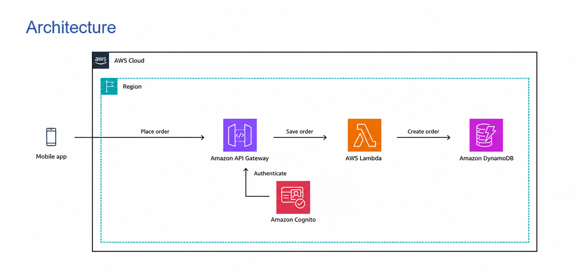

# AWS Serverless Order Management API

A serverless order-management API built with **Amazon API Gateway (HTTP API), AWS Lambda, Amazon DynamoDB, and Amazon Cognito**. The API supports creating orders and retrieving one or multiple orders, with Cognito JWT authentication protecting the API routes.

## Architecture



**Request flow**
1. A client sends an authenticated request to API Gateway.
2. API Gateway validates the Cognito JWT.
3. API Gateway invokes the `OrderManagementFunction` Lambda function.
4. Lambda reads from or writes to the `Orders` DynamoDB table.
5. The API returns a JSON response to the client.


## AWS services

- **Amazon API Gateway (HTTP API):** exposes `GET /orders` and `POST /orders`.
- **AWS Lambda:** implements the order-management logic.
- **Amazon DynamoDB:** stores order records in the `Orders` table.
- **Amazon Cognito:** authenticates users; a JWT authorizer protects both routes.
- **Amazon CloudWatch:** receives Lambda logs through the Lambda execution role.

## API routes

Base URL used during testing:

```text
https://1ig53b97n7.execute-api.ap-south-1.amazonaws.com/prod
```

| Method | Path | Purpose |
|---|---|---|
| `GET` | `/orders` | List up to 50 orders |
| `GET` | `/orders?orderId=ORD001` | Retrieve one order by ID |
| `POST` | `/orders` | Create an order |

Both routes require a valid Cognito JWT in the `Authorization: Bearer <token>` header.

### Example: create an order

```http
POST /orders
Content-Type: application/json
Authorization: Bearer <Cognito-JWT>
```

```json
{
  "orderId": "ORD003",
  "item": "Mouse"
}
```

The function assigns the initial status `PLACED` and a `createdAt` timestamp. Duplicate order IDs are rejected.

### Example response

```json
{
  "orderId": "ORD003",
  "item": "Mouse",
  "status": "PLACED",
  "createdAt": "2026-10-12T10:00:00.000Z"
}
```

## DynamoDB data model

Table: `Orders`

| Attribute | Type | Description |
|---|---|---|
| `orderId` | String (partition key) | Unique order identifier |
| `item` | String | Item being ordered |
| `status` | String | Initial status is `PLACED` |
| `createdAt` | String | ISO-8601 creation timestamp |

The table was configured with on-demand capacity for this learning project.

## Lambda function

The handler source is in [`lambda/index.mjs`](lambda/index.mjs). It uses the AWS SDK for JavaScript v3 DynamoDB Document Client.

Environment variable:

```text
ORDERS_TABLE=Orders
```

The Lambda execution role needs `dynamodb:PutItem`, `dynamodb:GetItem`, and `dynamodb:Scan` permissions scoped to the `Orders` table.

## Authentication

- Cognito user pool and app client configured for authorization-code sign-in.
- API Gateway HTTP API JWT authorizer configured with the Cognito issuer and app-client audience.
- An unauthenticated request returned `401 Unauthorized`.
- An authenticated `GET /orders` request returned `200 OK` with the stored orders.

Do not commit Cognito client secrets, bearer tokens, authorization codes, passwords, or `.env` files.

## Screenshots

Implementation evidence is available in [`screenshots/`](screenshots/). Screenshots containing visible tokens, authorization codes, or personal sign-in details have intentionally been excluded.

## Security and future improvements

- **Planned:** integrate AWS WAF using an API Gateway REST API architecture compatible with WAF. WAF is not attached to the current HTTP API.
- Consider adding input validation, pagination, structured logging, alarms, and automated tests before production use.
- Use least-privilege IAM permissions and avoid placing secrets in source control.

## Repository structure

```text
AWS-Serverless-Order-Management-API/
├── README.md
├── Architecture.md
├── architecture.png
├── lambda/
│   └── index.mjs
├── screenshots/
└── docs/
    └── cleanup.md
```

## Author

**Anushree Sindagi**
